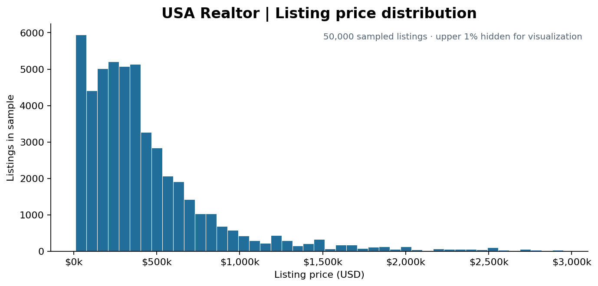
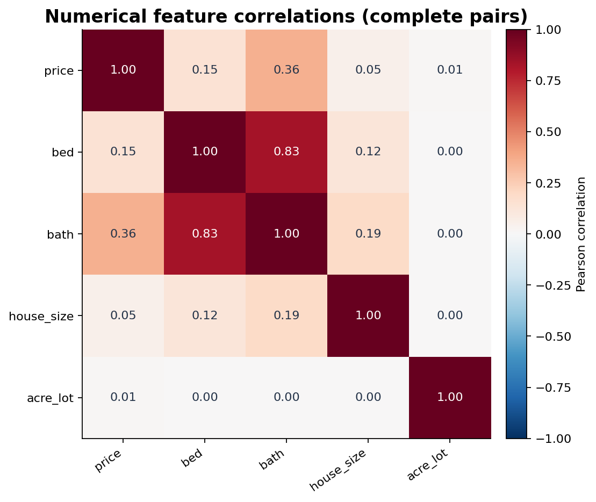
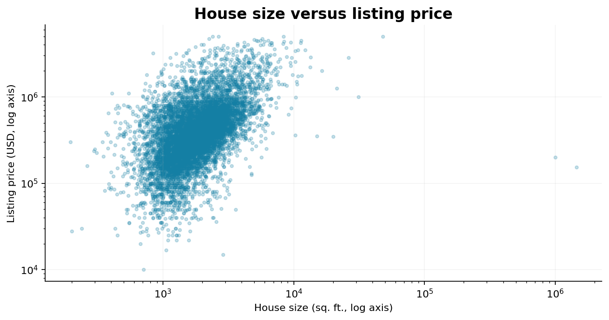
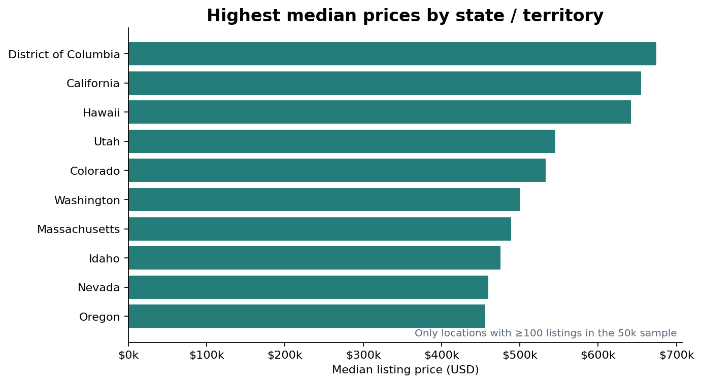
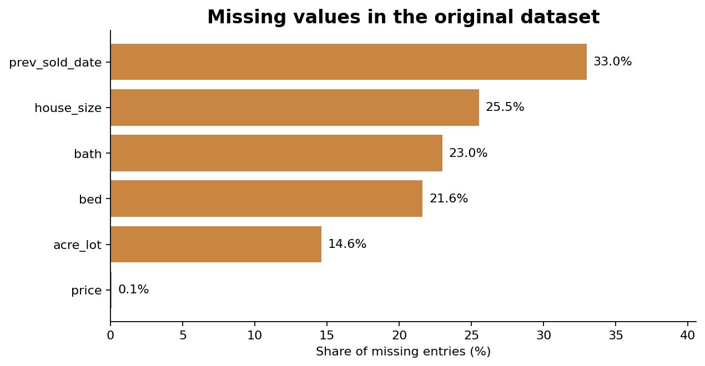
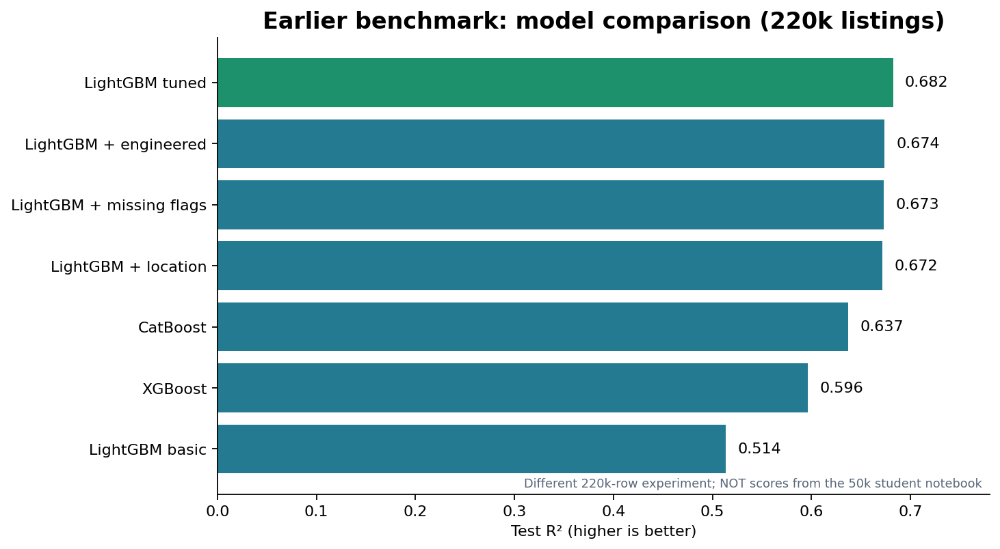

# USA Real Estate Price Prediction Using Machine Learning

Predict US residential property **listing prices** using property characteristics and geographic information, and compare familiar scikit-learn regressors with optional boosting models.

**Group:** Individual Project  
**Group Member:** Mujtaba Ahmed  

**Dataset:** [USA Real Estate Dataset — Kaggle](https://www.kaggle.com/datasets/ahmedshahriarsakib/usa-real-estate-dataset)  
**Problem type:** Supervised regression · **Target:** `price`  
**Notebook:** [`USA_Realtor_Price_Prediction.ipynb`](USA_Realtor_Price_Prediction.ipynb)

## Project overview

This project explores how bedrooms, bathrooms, house size, land area, listing status, and location (`state`, `city`, `zip_code`) relate to property listing prices. It includes data cleaning, missing-value handling, simple previous-sale-date features, visualizations, model training, and example predictions.

The notebook is deliberately split into two sections:

- **Part 1 — My Version:** Familiar scikit-learn `Pipeline`, `ColumnTransformer`, `SimpleImputer`, `OneHotEncoder`, and models such as Linear Regression, Ridge, Lasso, ElasticNet, SGD, Polynomial Regression, Random Forest, and Gradient Boosting.
- **Part 2 — ChatGPT Version (optional):** LightGBM, CatBoost, and XGBoost. This optional section is explicitly identified as AI-assisted.

## Dataset details

| Property | Information |
|---|---|
| Source | Kaggle: USA Real Estate Dataset |
| CSV used | `realtor-data.csv` |
| Rows in the provided CSV | 2,226,382 |
| Columns | 12 in the original CSV (12 total) |
| Target | `price` (listing price, USD) |
| Original features | `brokered_by`, `status`, `bed`, `bath`, `acre_lot`, `street`, `city`, `state`, `zip_code`, `house_size`, `prev_sold_date` |
| Modeling scope | Prices from $10,000 to $5,000,000; a reproducible 50,000-row sample in the simple notebook |

Missing values are an important challenge: `house_size` is missing in **568,484** rows (25.5%), and `prev_sold_date` in **734,297** rows (33.0%). These are not automatically deleted; the notebook uses numeric imputation and missingness flags. Missing target values are excluded from training.

## Exploratory data analysis

### Price distribution

### Numerical feature correlations

### House size and price

### Median listing price by state / territory

### Missing data

**Chart methodology:** These EDA charts use the same $10,000–$5,000,000 price scope and a deterministic 50,000-row sample from the supplied CSV. In the distribution chart, values above the sampled 99th percentile are hidden *for display only*. State medians are shown only for states/territories with at least 100 listings in the sample. Correlation is descriptive, not proof of causality.

## Models and evaluation

The student notebook uses a **70% training / 15% validation / 15% testing** split. Training and validation R² are compared to identify overfitting and select a model. The final held-out test set is for evaluation after selection.

The primary metrics are **R²**, **mean absolute error (MAE)** and **root mean squared error (RMSE)**. R² is not classification accuracy.

### Earlier advanced-model benchmark (different experiment)

The image above comes from a **separate, previously measured 220,000-row comparison**, not from running this simplified 50,000-row notebook. In that experiment, tuned LightGBM reached **test R² = 0.6824** and **test MAE = $143,646**. Different samples and encoding methods mean the scores are not directly interchangeable.

For model scores from **this notebook**, run its cells and inspect the generated `realtor_student_scores.csv` and `realtor_all_model_scores.csv` files.

## How to run

1. Download `realtor-data.csv` from the [Kaggle dataset page](https://www.kaggle.com/datasets/ahmedshahriarsakib/usa-real-estate-dataset) and place it next to the notebook.
2. Open the notebook in VS Code or Jupyter and select the correct Python virtual-environment kernel.
3. Install requirements: `python -m pip install -r requirements.txt`.
4. Run cells from top to bottom. **Part 2 is optional** if you only want scikit-learn models.
5. Review the model-score tables, plots, and real held-out test examples at the end.

> The original CSV is omitted from this repository because it is large. Download it from Kaggle. Check the source dataset license and attribution requirements before redistributing it.

## Limitations

- The target is **advertised listing price**, not confirmed final sale price.
- Missing data and unusual property values require careful handling.
- Previous-sale-date features assume a **2022-12-31** reference cutoff; that date is a modeling assumption rather than a known listing date.
- Geographic generalization to unseen cities is challenging, and random listing-level splits may place similar properties in training and validation sets.
- Predictive performance on the full 2.2-million-row dataset has **not** been established by the simplified notebook.

## Project proposal

See [`Project_Proposal.docx`](Project_Proposal.docx) for a stand-alone description of the title, goals, dataset, methods, expected outcomes, and dataset URL.
